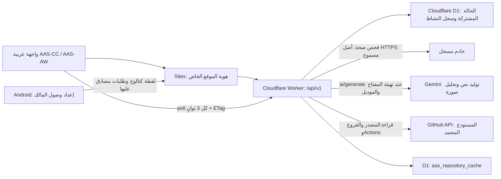

# معمارية AAS-CC وAAS-AW الحالية

واجهة ربط Gemini الحالية تجلب قائمة النماذج من Google بالمفتاح، بدل كتابة اسم النموذج يدويًا. يحمل `provider-gemini-discovery` مسودة واحدة مشفرة مرتبطة بمعرّف عشوائي وصلاحية عشر دقائق، ولا يغيّر سجل `provider-gemini` النشط. يحفظ اختيار النموذج بمعرّف الجلسة دون إعادة إرسال المفتاح، ويُعاد التحقق من بيانات النموذج قبل اعتماد الإعداد. يُرفض الاختيار إذا لم يكن ضمن القائمة أو انتهت الجلسة أو استُبدلت بفحص جديد. يبقى عقد الإعداد السابق متاحًا لعملاء API.

## المكونات المنفذة

| الجزء | المسؤولية الحالية |
| --- | --- |
| `dist/` | العرض العربي RTL، النماذج والبحث والتصفية، حالات الاتصال، التصدير والاستيراد. |
| عميل API | تحميل الحالة، إرسال التغييرات، منع الكتابة الصامتة عند تعارض الإصدار، إعادة مزامنة الحالة. |
| Worker | المصادقة، التحقق من الطلبات، مسارات API، تسجيل التغييرات، وفحوص اتصال الخوادم ومتابعة المستودع. |
| D1 | حفظ حالة المؤسسة المشتركة بشكل دائم؛ حالة واحدة مع رقم مراجعة تزداد قيمته بعد كل تغيير. |
| Sites | استضافة الواجهة وتشغيل Worker وربط D1 وتمرير هوية ChatGPT للموقع الخاص. |
| GitHub | ملاحظات من API حول المصدر والفروع وتشغيلات Actions؛ قراءة فقط من المستودع المحدد. |
| عميل Android المبدئي | مسودة محلية لإعداد الوصول وفحص الصحة وإرسال لقطة Room؛ لم تُنشر في المستودع أو يُثبت اتصال جهاز بها. |

التخزين قائم على صف حالة واحد بإصدار، وتُنفذ الكتابة بطريقة مقارنة الإصدار قبل الاستبدال (CAS). يرسل العميل الإصدار المتوقع، ويعيد الخادم خطأ تعارض إذا تغيّرت الحالة في طلب آخر. هذا يمنع الكتابة فوق تعديل أحدث؛ لا يمثل نموذجًا علائقيًا مستقلًا لكل كيان، ولا نظام عزل متعدد المؤسسات.

جدول `aas_repository_cache` مستقل عن مراجعة حالة المؤسسة. يحفظ لقطة المستودع وتوقيت آخر نجاح ومحاولة وخطأ الجلب. `GET /github` يستخدم صلاحية خمس دقائق؛ `POST /github/refresh` يمكنه طلب تحديث بعد مرور دقيقة على آخر محاولة. لا يزيد تحديث الملاحظة مراجعة مهام المؤسسة، ولا ينشئ سجل تنفيذ تطبيق.

## البيانات

الحالة ذات `schemaVersion: 2` و`demoMode: false`، وتجمع إعدادات المؤسسة، وملفات الوكلاء، والمساحات، والمهام، والموافقات، والملاحظات، والخوادم وسجل النشاط، و`commerce` للقطة التطبيق. يُنشأ سجل النشاط عند تغيير فعلي. لا تُزرع مهام أو موافقات أو منتجات أو طلبات أو نشاط أولي يوحي بتشغيل متجر أو وكيل.

تُستقبل `commerce` عبر `POST /api/v1/app/sync` باستخدام مصادقة الخدمة فقط. يتحقق الخادم من حقول المنتج والطلب ويحتفظ بالحقول المسموحة دون بيانات العملاء أو الدفع، ويحدد `receivedAt` من وقت الخادم. كل لقطة تستبدل لقطة التطبيق السابقة؛ ليست مزامنة دمج متعددة الأجهزة أو تحققًا من البيع والدفع. الاستيراد وإعادة الضبط يحافظان على اللقطة المستلمة، ولا يستطيع تعديل عادي في اللوحة إنشاء إيصال تطبيق.

ملفات الوكلاء الأولية تصف التخصصات والأدوات المقترحة. تعديل الملف أو تغيير حالته في لوحة الإدارة يحفظ إعدادًا؛ لا يستدعي نموذج ذكاء اصطناعي ولا يبدأ عملية تنفيذ.

مساعد `dist/legacy-migration.js` يحافظ على عمل المستخدم المضاف يدويًا في النسخة المحلية القديمة عند أول انتقال إلى قاعدة حية جديدة في المراجعة `0`. يتحقق من النسخة ذات الأصل نفسه، ويستبعد معرفات مهام وملاحظات وموافقات العرض الأولي ونشاطه، ثم يرسل نسخة حية للتحقق والاستيراد مرة واحدة. تبقى نسخة المتصفح القديمة دون حذف؛ وجود عمل خادمي أو تعارض مراجعة يمنع الدمج التلقائي.

## متابعة المصدر والبناء

الربط المباشر المنفذ هو قراءة `Mohammadzxzx1991/Mohammad-Ahmed-Ghannam` من GitHub، وعرض HEAD والتزامات الفرع الافتراضي والفروع وتشغيلات Actions وتوقيت الفحص. يحفظ فشل التحديث آخر لقطة بعلامة قدم واضحة. إذا تعذرت قراءة Actions مع نجاح بقية المصدر، تظهر حالة عدم توفر نتائج البناء.

لا تشغل هذه الطبقة بناءً، ولا تنشر كودًا، ولا تنشئ PR، ولا تقرأ تعديلات جلسة Codex غير المنشورة. لقطة GitHub لا تثبت أن الجهاز المثبت يستخدم تلك النسخة؛ لقطة `commerce` تحتاج رسالة مصادقًا عليها من التطبيق نفسه. `GITHUB_TOKEN` اختياري للقراءة ويأتي من بيئة الخادم، ولا يدخل الحالة أو المصدر.

## الوصول والأسرار

طلب المتصفح إلى الموقع الخاص يعتمد على هوية ChatGPT التي يتحقق منها Worker. التكامل الخادمي أو تطبيق Android المهيأ بواسطة المالك يستخدم `X-AAS-API-Key` المطابق لسر `AAS_API_TOKEN`؛ يحتاج الوصول المنشور إلى الموقع الخاص أيضًا إلى رمز `OAI-Sites-Authorization`. لا تضمّن هذه الرموز في ملفات واجهة الويب أو مستودع المصدر أو APK أو `localStorage` أو نسخ تصدير العمل.

`POST /app/connection-config` يتيح لهوية المتصفح في الموقع الخاص تنزيل ملف اتصال مخصص للمالك، مستمدًا من أسرار Worker. الملف يحتوي مفاتيح وصول فعلية. في تصميم مسودة Android، يُستورد صراحةً ويحفظ بتشفير AES-GCM ومفتاح Android Keystore، وتُستثنى بيانات الوصول من النسخ الاحتياطي للجهاز. تنزيل الملف لا يربط جهازًا ولا يزامن البيانات، وتبقى المزامنة التلقائية معطلة في الملف. وصول الخدمة وحده لا يتيح تنزيل إعداد المالك.

هذا الإصدار مؤسسة مشتركة واحدة. دخول عدة مستخدمين إلى الموقع يعني الوصول إلى الحالة المشتركة نفسها وفق وصول Sites؛ لا توجد حتى الآن عضويات مؤسسات أو أدوار تطبيقية أو سياسات عزل على مستوى الكيان.

## فحص الخوادم

سجل الخادم يحتوي على `baseUrl` و`apiPrefix` و`healthPath` و`tokenEnv`. الحقل الأخير اسم متغير بيئة فقط، ولا يحتوي قيمة السر. يقيد Worker الطلبات الخارجية إلى أصول HTTPS المدرجة في `AAS_ALLOWED_SERVER_ORIGINS`، ويمنع عناوين IP وأسماء المضيفين المحلية المعروفة، ولا يتبع إعادة توجيه. تسجيل عنوان في الواجهة لا يمنحه إذن الاتصال تلقائيًا. يجب مراجعة أصل النطاق قبل إدخاله في قائمة السماح؛ لا يتضمن هذا الإصدار تحققًا مستقلًا من كل نتيجة DNS. تعرض نتيجة الفحص الحالة التي أرجعها الاتصال الحقيقي.

الفحص يتحقق من إمكانية الوصول إلى مسار الصحة؛ لا يثبت أن API المنتجات أو الطلبات أو الكتابة متوافق أو أن التطبيق الآخر متصل بالكامل. الربط الفعلي يحتاج محولًا لعقد الخادم ونطاق صلاحيات محددًا واختبار رحلة متجر كاملة.

## الطبقة التالية

المصدر المنشور محدد في GitHub ويمكن متابعته من اللوحة. توجد مسودة Android محلية في `/workspace/apps/mohammad-ahmed-ghannam`، لكن نشرها متوقف بسبب اختلاف هوية وصور تطبيق Luqta عن النسخة المنشورة التي فُحصت. لم تُدفع هذه المسودة ولم يُثبت بناء APK أو اتصال جهاز. تشغيل الاتصال يحتاج توحيد النسخة المقصودة ثم بناءها وتثبيتها وإعداد المالك وإيصال مزامنة حقيقي. التغييرات غير المنشورة في جلسة Codex الأخرى غير متاحة هنا. API البحث متاح لقراءة لقطة الكتالوج؛ مقارنة الأسعار تعيد سعر المتجر المسجل، ولا تضيف عروض منافسين. مسارات الرادار والبيانات الاجتماعية تعيد `503 integration_not_configured`.

`POST /ai/generate` يتيح طلبات النص والصورة عبر محول Gemini في Worker. عميل التطبيق الذي يرسل هذه الطلبات جزء من المسودة المحلية غير المنشورة. مفتاح `GEMINI_API_KEY` والموديلات المسموحة يهيئها مسؤول الخادم؛ المفتاح لا يصل إلى تطبيق Android. عند غياب المزود يعاد `503 provider_not_configured` دون إرسال طلب أو إنشاء نتيجة. هذا استدعاء نموذج عند الطلب، وليس عامل تنفيذ مستقلًا أو تشغيلًا لأدوات المتجر.

تشغيل الوكلاء الفعلي يتطلب طابور تنفيذ وحدود تشغيل ونتائج قابلة للتحقق، وفرض موافقات على الإجراءات الخارجية. مزامنة المخزون والطلبات إلى مصدر متجر مستقل، أو مزامنة عدة أجهزة، تحتاج عقدًا أوسع من لقطة Room الحالية. هذه المكونات ليست منفذة في النسخة الحالية.

## تنظيم الفريق والمحادثة وإعداد المزود

تضم الحالة الحالية تسعة ملفات تنظيمية للوكلاء، مع مساحة تقنية وأدوار للتحليل والبرمجة والاختبار تحت إشراف المنسّق. تعتمد جدولة المهام على الاعتماديات وموارد الملفات المعلنة؛ يمنع الخادم التعارضات وفق هذه السجلات، دون فرض قفل على عمليات خارج المركز. تعريف تسعة ملفات لا يعني وجود تسعة نماذج متصلة أو عمليات مستقلة تعمل في الخلفية.

تقرأ المحادثة ملخصًا محدودًا من الحالة الفعلية والسجل، وتقترح عمليات مسموحة فقط. تُحفظ المقترحات على الخادم، ويحتاج تطبيقها إلى اعتماد صريح والتحقق مجددًا من الحالة والإصدار. لا تتحول رسالة المحادثة إلى SQL أو أمر نظام أو دليل تنفيذ. عند غياب Gemini يظهر وضع «المستشار المحلي» وتوصيات محددة منفصلة، مع تصريح بأن نموذجًا لم يولّد الرد.

يمكن للمالك إعداد Gemini من نموذج مخصص خارج المحادثة. يتحقق الخادم من بيانات النموذج ودعمه `generateContent` بطلب قراءة، ثم يحفظ المفتاح في `aas_control_records` مشفرًا بـAES-256-GCM وIV عشوائي ومفتاح خادم `AAS_SECRET_ENCRYPTION_KEY`. لا تعيد واجهة الإعداد قيمة المفتاح. يستخدم `/ai/generate` والمساعد الإعداد نفسه؛ يبقى رد التوليد المشترك بصيغة `{ content, model }`. الإعداد المشفر غير القابل للقراءة يفشل صراحةً، ولا يُتجاوز بصمت بإعداد بديل.

## جسر SQLite المحلي

تُحفظ سجلات المحادثة والمقترحات ووصلات قاعدة البيانات وطوابيرها في `aas_control_records`، مستقلة عن مراجعة مهام المؤسسة. يعمل جسر SQLite من الجهاز المحلي باتصال HTTPS صادر ومصادقة مخصصة، ويرسل مخططًا وعيّنات محدودة وفق إعداداته المحلية. تبدأ الوصلة بحالة `waiting`؛ إنشاء الوصلة في اللوحة لا يثبت تشغيل الجسر أو الوصول إلى الشبكة المحلية.

تقتصر الكتابة على عمليات صفوف منظمة وجداول وأعمدة سمح بها الجسر محليًا، مع نسخ احتياطي ومعاملات وإزالة تكرار وإيصالات نتيجة. إدراج العملية في الطابور لا يثبت تغيير القاعدة؛ النتيجة تأتي من إيصال الجسر. لا يدعم هذا المسار SQL اعتباطيًا، ولا يتيح لخادم السحابة الوصول المباشر إلى عنوان LAN غير متاح.

هذه الإضافات لا تعيد تطبيق ملفات GitHub Actions التي تراجع عنها تاريخ `main`، ولا تثبت تشغيل منفّذ شيفرة خارجي. يبقى أي تغيير للمستودع أو تحقق خارجي مرتبطًا بمساره وأدلته وصلاحياته الفعلية.
